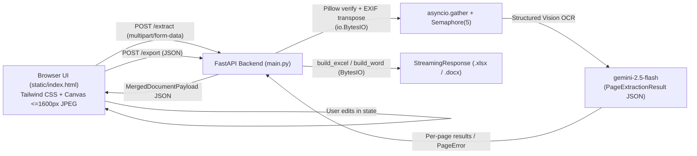

# Implementation & Technical Specification

## 1. System Overview

The **Adaptive Batch Image-to-Document Extractor** is a stateless, in-memory web application that converts 1–15 document photographs into editable, styled **Excel (`.xlsx`)** workbooks or **Word (`.docx`)** documents.

### Architecture

### Repository Layout
- `main.py` — FastAPI application, image validation, concurrent Gemini OCR, batch merging, and in-memory `.xlsx`/`.docx` generators.
- `static/index.html` — Single-file responsive HTML5/Tailwind CSS/Vanilla JS frontend.
- `static/tailwind.js` — Local Tailwind browser runtime (zero internet, zero compile step).
- `requirements.txt` — Python package dependencies.
- `.env.example` — Environment template (`GEMINI_API_KEY`).
- `app_script/windows/` — `install_requirements.ps1`, `install_requirements.bat`, `start_server.ps1`, `start_server.bat` (Windows virtual-environment bootstrap, dependency install, and `uvicorn` launcher).
- `app_script/linux_mac/` — `install_requirements.sh`, `start_server.sh` (Linux/macOS virtual-environment bootstrap, dependency install, and `uvicorn` launcher).
- `docs/SETUP.md` — Installation and usage guide.
- `docs/IMPLEMENTATION.md` — This technical specification.

---

## 2. Backend Specifications (`main.py`)

### Configuration & Limits
| Constant | Value | Purpose |
| :--- | :--- | :--- |
| `MAX_BATCH_SIZE` | `15` | Maximum images per `/extract` request |
| `MAX_FILE_SIZE_BYTES` | `10 * 1024 * 1024` (10 MB) | Maximum raw size per uploaded image |
| `RATE_LIMIT_REQUESTS` | `15` | Max `/extract` requests per IP per window |
| `RATE_LIMIT_WINDOW_SECONDS` | `60` | Sliding-window duration in seconds |
| `GEMINI_CONCURRENCY` | `5` | Max concurrent `gemini-2.5-flash` calls |
| `GEMINI_MODEL` | `"gemini-3.8-flash"` (overridable via `GEMINI_MODEL` env var) | Vision OCR model |
| `Image.MAX_IMAGE_PIXELS` | `40_000_000` | Pillow decompression-bomb guard |

### Pydantic Data Models
- **`ProseBlock`**: Represents one logical block in a prose/letter/mixed document.
  - `kind`: `"single" | "split_row" | "table"`
  - `text`, `alignment` (`"left" | "center" | "right"`), `is_bold` (for `"single"`)
  - `left_text`, `right_text` (for `"split_row"`)
  - `table_headers`, `table_rows` (for `"table"`)
- **`PageExtractionResult`**: Structured schema enforced on Gemini's JSON output (`temperature=0.1`).
  - `layout_type`: `"tabular" | "prose"`
  - `suggested_filename`: `str`
  - `headers`, `rows` (populated for `"tabular"`)
  - `blocks`: `list[ProseBlock]` (populated for `"prose"`)
- **`ExcelSheetPayload`**: `sheet_name`, `headers`, `rows`.
- **`PageError`**: `page_index`, `filename`, `reason`.
- **`MergedDocumentPayload`**: Shared contract returned by `POST /extract` and accepted by `POST /export`.
  - `output_format`: `"excel" | "word"`
  - `filename`, `pages_processed`, `failed_pages`
  - `sheets`: `Optional[list[ExcelSheetPayload]]`
  - `pages`: `Optional[list[list[ProseBlock]]]`

### API Endpoints
- **`GET /` (`serve_index`)**: Serves `static/index.html` via `FileResponse` (with `/static` mounted for `static/tailwind.js`).
- **`POST /extract` (`extract_documents`)**:
  - Accepts `files: list[UploadFile]` and `mode: Literal["auto", "excel", "word"] = "auto"`.
  - Enforces rate limiting (`429`), `GEMINI_API_KEY` presence (`500`), batch size (`400`), and per-file size (`413`).
  - Validates magic bytes and normalizes EXIF orientation in memory; records per-page failures in `failed_pages` (returns `422` if all pages fail).
  - Resolves `output_format` from `mode` or majority vote across valid pages (defaulting to `"excel"` on ties) and merges all valid pages.
- **`POST /export` (`export_document`)**:
  - Accepts `MergedDocumentPayload` JSON, generates `.xlsx` or `.docx` in `io.BytesIO`, and streams it with `StreamingResponse` and `Content-Disposition: attachment`.

### Backend Functions Reference
| Function | Role |
| :--- | :--- |
| `_get_client_ip(request)` | Resolves client IP from `X-Forwarded-For` or `request.client.host`. |
| `_check_rate_limit(request)` | Sliding-window in-memory per-IP rate limiter (`HTTP 429`). |
| `_sanitize_filename(name, fallback)` | Produces a safe filename slug (max 80 chars). |
| `_validate_and_normalize_image(raw_bytes)` | Runs `Image.verify()`, re-opens image, applies `ImageOps.exif_transpose()`, flattens alpha onto white, and exports JPEG bytes (`quality=90`). |
| `_build_extraction_prompt(mode)` | Builds mode-specific OCR instructions (`auto`, `excel`, `word`). |
| `_extract_single_page(...)` | Calls `client.aio.models.generate_content` under `asyncio.Semaphore(5)` and parses `PageExtractionResult`. |
| `_normalize_row(row, width)` | Pads or truncates row cells to match header column count. |
| `_headers_match(h1, h2)` | Case-insensitive stripped comparison of two header lists. |
| `_prose_to_sheets(blocks, page_num)` | Converts prose/embedded-table blocks into `ExcelSheetPayload` items when a mixed batch resolves to Excel. |
| `_merge_excel_pages(valid_pages)` | Merges matching-schema pages into `Extracted_Records` (deduplicating repeated header rows) and places distinct schemas on `Page_<N>` sheets. |
| `_merge_word_pages(valid_pages)` | Groups each page's `ProseBlock` list (converting any tabular page into a `table` block). |
| `_sanitize_sheet_name(name, existing)` | Strips `: \ / ? * [ ]`, caps at 31 chars, and deduplicates worksheet names. |
| `_parse_numeric_cell(raw)` | Strips `GHS`, `₵`, `$`, `€`, `£`, commas, and accounting parentheses; returns `(int/float, format)` while preserving leading-zero identifiers (e.g., `"00412"`) as `str`. |
| `build_excel(payload)` | Generates styled `.xlsx` with `#1F4E78` navy headers, bold white text, numeric formatting, and auto-fitted column widths (max `45`). |
| `_strip_table_borders(table)` | Removes all `w:tblBorders` XML borders for borderless `split_row` tables. |
| `_set_cell_padding(cell, ...)` | Sets `w:tcMar` cell padding in `dxa`. |
| `_shade_cell(cell, hex_color)` | Applies `w:shd` background fill to table header cells. |
| `build_word(payload)` | Generates `.docx` with `Calibri 11pt` default font, page breaks between pages, aligned paragraphs, borderless 2-column `split_row` tables, and `Table Grid` embedded tables. |

---

## 3. Frontend Specifications (`static/index.html`)

Built with **Tailwind CSS** (local `static/tailwind.js`) and state-driven Vanilla JavaScript (`currentPayload` as the single source of truth):

### Client-Side Constants
- `MAX_BATCH = 15`, `MAX_EDGE = 1600`, `JPEG_QUALITY = 0.85`.

### Stage 1 — Queue & Image Optimization
- `compressImage(file)` — Resizes images exceeding `1600px` on the longest edge via offscreen `<canvas>` and exports JPEG at `85%` quality.
- `handleFiles(fileList)` — Enforces the 15-image queue cap and appends compressed items.
- `renderQueue()`, `removeQueueItem(idx)`, `moveQueueItem(idx, delta)`, `clearQueue()`, `setMode(mode)` — Manage the thumbnail strip, page order, and format mode (`auto`, `excel`, `word`).
- `runExtraction()` — Posts `FormData` to `POST /extract` and transitions to Stage 2.

### Stage 2 — Split-View Preview & Interactive Editing
- `enterStage2()`, `renderReferenceImage()`, `prevRefPage()`, `nextRefPage()`, `setMobileTab(tab)` — Renders the desktop split-view (reference image + editor) and mobile tab switcher.
- `renderFailedBanner()`, `dismissFailedBanner()`, `replaceFailedPage(pageIndex, failedArrIdx, inputEl)` — Displays per-page OCR errors and allows replacing/re-extracting individual failed pages in place.
- **Excel Editor:** `renderExcelEditor()`, `switchSheet(idx)`, `updateExcelHeader(cIdx, val)`, `updateExcelCell(rIdx, cIdx, val)`, `addExcelRow()`, `deleteExcelRow(rIdx)`, `addExcelColumn()`.
- **Word Editor:** `renderWordEditor()`, `renderWordBlock(pIdx, bIdx, block)`, `updateWordText(...)`, `setWordAlign(...)`, `toggleWordBold(...)`, `deleteWordBlock(...)`, `addWordParagraph(...)`, `updateSplitRow(...)`, `updateWordTableHeader(...)`, `updateWordTableCell(...)`, `addWordTableRow(...)`, `deleteWordTableRow(...)`.

### Stage 3 — Export & Reset
- `exportDocument()` — Sends `currentPayload` to `POST /export` and triggers a browser download of `<filename>.xlsx` or `<filename>.docx`.
- `startOver()` — Revokes object URLs, clears `queue` and `currentPayload`, and returns to Stage 1.
